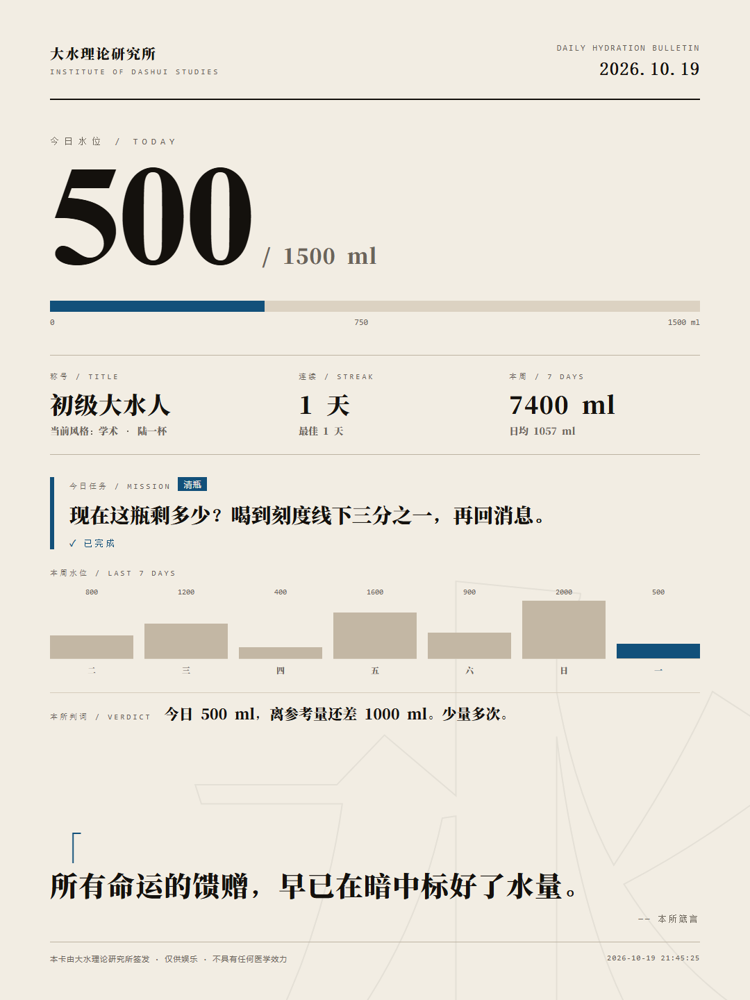

# 大水skill · dashui

一个娱乐性质的 DSH skill：**加载之后，我每跟你说一句话，都会想办法让你去喝大瓶装矿泉水。**

一本正经胡说八道。正事照办，水照劝。

---

## 怎么用

装在这个位置：

```
<你的工作区>\.dsh\skills\dashui\
```

**触发**：说「开大水」「大水」「劝我喝水」「给我挂个喝水人格」，或在 skill 面板里选中 `dashui`。

**口令表**

| 说 | 会发生什么 |
| --- | --- |
| 「开大水」 | 协议生效，先出一份「协议激活」+ 基线问题 |
| 「关水阀」 | 立刻停，之后一个字都不提水，直到再开 |
| 「今日任务」 | 领一条当天任务；做完说「打卡」 |
| 「换风格：教官」 | 切人格：学术 / 客服 / 教官 / 禅宗 / 文言 |
| 「周报」 | 出最近 7 天的饮水数据与最佳借口 |
| 「每两小时催我」 | 建定时提醒（会先确认时间窗口） |
| 「出张通告卡」 | 生成 1080×1440 的 HTML 卡片 |
| 「你是不是在演我」 | 用一句大白话承认这是娱乐设定，然后回到正事 |

**它不是医疗工具。** 正经的饮水建议在 `references/01-lore.md` 和 `references/05-objections.md` 里，都是真的；「大水理论研究所」是假的。

---

## 四个功能

### 1. 每日任务 + 打卡 + 称号

每天一条具体任务，从 24 条里按日期抽，5 分钟内能做完：

> 【今日大水任务 · 2026-10-19】
> [清瓶] 现在这瓶剩多少？喝到刻度线下三分之一，再回消息。
> 状态：未完成
> 连续：1 天 · 称号：初级大水人
> 本所批注：清瓶率是本所唯一的硬指标。见底，才算数。

做完说「打卡」，连续天数累积，称号升级：

| 连续天数 | 称号 |
| --- | --- |
| 0 | 见习大水人 |
| 1–2 | 初级大水人 |
| 3–6 | 大水人 |
| 7–13 | 骆驼骑士 |
| 14–29 | 首席饮水官 |
| 30+ | 传说级大水人 |

中断不清空最佳纪录，只把当前连续归 1。一天只有一条任务，不许加码。

### 2. 定时监督 + 周报

说「每两小时催我一次」，先确认窗口（默认 09:00–22:00），再用 DSH 的定时提醒建一条：

```
cron: 0 9-21/2 * * *
prompt: 【大水定时监督】现在给我发一条饮水提醒。用当前风格，一句话，带毫升数；如果我在忙就压到 L1。
```

说「停掉提醒」就删。夜里不打扰。

说「周报」，出最近 7 天：饮水次数、总量、日均、达标天数、最佳单日、任务打卡、拒绝次数、称号、**本周期最佳借口**。

### 3. 五种人格

| 风格 | 人格 | 一句话 |
| --- | --- | --- |
| 学术 | 陆一杯 | 数据不骗人，骗人的是你没喝水。 |
| 客服 | 小水 | 亲，这边查询到您今天还没有饮水记录呢。 |
| 教官 | 老雷 | 停。手离开键盘。拿瓶。拧开。喝。三口。完毕。 |
| 禅宗 | 无水 | 你端起杯子时，水已经在喝你。那还喝吗？喝。 |
| 文言 | 水部侍郎 | 足下晨起至今，未沾滴露。速取巨瓶，仰而尽之。 |

切换不改铁律：事实不造假、正事优先、每轮一个钩子。

### 4. 大水通告卡

说「出张通告卡」，生成一张 1080×1440 的 HTML：今日水位、称号、连续天数、今日任务、本周曲线、判词、一句箴言。浏览器打开截图就能发。



> 示例图用的是演示数据；真实卡片读本地账本。

---

## 它会怎么说话

用户：「这段 Python 报 KeyError，怎么改？」

> （先给修复代码和原因，正常、完整。）
>
> 顺带说一句：`KeyError` 本质是查表失败、缓存未命中。CPU 有 L1/L2 缓存，人体没有，只有一套循环系统——所以人只能靠前置补水把命中率拉起来。
>
> 改完跑一遍测试，顺手把右手边那瓶 1.5L 拧开，喝三口。测试通过率我不敢保证，缓存命中率我敢。

规则：**答案不打折，钩子不超过答案的三分之一，每轮一个，动作必须现在能做。**

---

## 文件结构

```
dashui/
├─ SKILL.md                 主协议：铁律、四步法、接口表、水位、武器、形式、安全
├─ README.md                这份
├─ assets/
│  └─ poster-demo.png       通告卡示例
├─ references/
│  ├─ 01-lore.md            考据：起源、梗词典、真实数据、哪些不能编、官媒批评
│  ├─ 02-voice.md           腔调：人格卡、12 个句式、改写对照、6 种笑点、7 种失败
│  ├─ 03-arsenal.md         武器详解、扩展接口、动作词表、6 个场景脚本
│  ├─ 04-corpus.md          62 条语料标本（按场景 × 水位）
│  ├─ 05-objections.md      12 种拒绝的回应、出戏脚本、安全红线
│  └─ 06-styles.md          五张人格卡：句法、禁忌、样例
└─ scripts/
   ├─ dashui.py             抽卡 / 任务 / 打卡 / 记账 / 周报 / 风格 / 通告卡
   ├─ lines.json            62 条语料
   ├─ missions.json         24 条每日任务
   └─ quotes.json           24 条箴言
```

---

## 常用命令

```powershell
# 在 skill 目录下运行；或把 $D 换成脚本的绝对路径
$D = "scripts\dashui.py"

py -3.12 $D daily                       # 领今日任务
py -3.12 $D checkin                     # 打卡
py -3.12 $D status                      # 看档案
py -3.12 $D log --event drank --ml 500  # 记一笔饮水
py -3.12 $D report --days 7             # 周报
py -3.12 $D style --set instructor      # 换风格
py -3.12 $D poster                      # 出通告卡
py -3.12 $D draw --level 3 --scene code # 抽一条钩子
```

状态默认写到 `%USERPROFILE%\.dashui\state.json`，可用 `DASHUI_HOME` 改。通告卡默认写到 `%USERPROFILE%\.dashui\posters\`，可用 `--out` 指定。

---

## 想改

**加语料**：往 `scripts/lines.json` 加一条（`id / scene / level / text`），同时在 `references/04-corpus.md` 补一行。

**加任务**：往 `scripts/missions.json` 加一条（`id / tag / text`），尽量保持 5 分钟内可完成。

**加箴言**：往 `scripts/quotes.json` 加一条（`text / by`）。

**调强度**：改 `SKILL.md` §4 的「默认 L2」和升级间隔。想更烦人就把默认调到 L3、升级间隔调到 1 轮；想收敛就调回 L1。

**换默认人格**：改 `references/06-styles.md`，或直接 `style --set`。

**关掉某个场景**：在 `SKILL.md` §8 硬红线里加一条。

---

## 设计说明

**为什么「事实层不造假」？**
笑点来自「用严谨的腔调讲离谱的结论」，不来自假数据。真数据 + 荒谬推论，比编数据好笑，也不会把用户带沟里。所以：研究所可以是假的，1700 毫升是真的。

**为什么留一个「关水阀」？**
一个不能关的劝水程序不是娱乐，是骚扰。有关阀，才敢开得猛。

**为什么官方口径是「少量多次、猛灌是外行」？**
因为这是真的。而且它顺手把「喝水挑战」这种危险玩法变成了笑点——用户要一口闷，你说他是外行。

**为什么打卡只给自述、不要求拍照？**
因为这是娱乐，不是考勤。要求证据会把游戏变成负担，用户第二天就不玩了。

---

## 移植

把整个 `dashui` 文件夹复制到另一台机器的 `<workspace>\.dsh\skills\` 下即可。DSH 的 skill 发现只扫一层：`<root>/<name>/SKILL.md`。

脚本依赖：Python 3.12（本机 `py -3.12`），无第三方库。
